TaskTracker is a task, habit, and time-tracking application. Users authenticate, enter a protected workspace, and manage tasks and habits; the frontend also exposes calendar, analytics, settings, and administration views. Feature pages use an API hook to call the backend, while authentication calls it directly. Backend internals and several page-to-server connections were not excerpted, so only clearly evidenced links are shown; unsampled administrative and analytics wiring is left unverified.

```mermaid
flowchart TD

subgraph group_frontend["Frontend experience"]
  node_app["Routes and access<br/>[App.js]"]
  node_layout["Workspace layout<br/>[Layout.js]"]
end

subgraph group_identity["Identity and preferences"]
  node_auth["Authentication<br/>[AuthContext.js]"]
  node_theme["Theme preferences<br/>[ThemeContext.js]"]
end

subgraph group_domains["Product domains"]
  node_tasks["Task management<br/>[TasksPage.js]"]
  node_habits["Habit tracking<br/>[HabitsPage.js]"]
  node_habitdetail["Habit details<br/>[HabitDetailPage.js]"]
  node_timer["Active timer<br/>[ActiveTimer.js]"]
  node_analytics["Analytics<br/>[AnalyticsPage.js]"]
  node_calendar["Calendar<br/>[CalendarPage.js]"]
  node_dashboard["Dashboard<br/>[DashboardPage.js]"]
  node_settings["Settings<br/>[SettingsPage.js]"]
  node_admin["Administration<br/>[AdminPage.js]"]
end

subgraph group_backend["Backend services"]
  node_api["API client<br/>[useApi.js]"]
  node_server["Backend API<br/>[server.py]"]
  node_diagnostics["Diagnostics<br/>[diagnostics.py]"]
end

node_user(("User"))

node_user -->|"opens"| node_app
node_app -->|"provides identity"| node_auth
node_app -->|"provides theme"| node_theme
node_app -->|"routes workspace"| node_layout
node_app -->|"routes tasks"| node_tasks
node_app -->|"routes habits"| node_habits
node_app -->|"routes habit detail"| node_habitdetail
node_app -->|"routes analytics"| node_analytics
node_app -->|"routes calendar"| node_calendar
node_app -->|"routes dashboard"| node_dashboard
node_app -->|"routes settings"| node_settings
node_app -->|"routes admin"| node_admin
node_layout -->|"renders"| node_timer
node_tasks -->|"requests task data"| node_api
node_habits -->|"requests habit data"| node_api
node_habitdetail -->|"requests habit data"| node_api
node_timer -->|"requests sessions"| node_api
node_calendar -->|"requests data"| node_api
node_dashboard -->|"requests data"| node_api
node_api -->|"calls HTTP API"| node_server
node_auth -->|"calls auth API"| node_server
node_server -->|"imports"| node_diagnostics
node_analytics -.->|"requests analytics"| node_api
node_admin -.->|"uses admin API"| node_server
node_settings -->|"uses identity"| node_auth
node_layout -->|"reads identity"| node_auth
node_layout -->|"reads theme"| node_theme

click node_app "https://github.com/said-mammadov/app-tasktrace/blob/main/frontend/src/App.js"
click node_layout "https://github.com/said-mammadov/app-tasktrace/blob/main/frontend/src/components/Layout.js"
click node_auth "https://github.com/said-mammadov/app-tasktrace/blob/main/frontend/src/context/AuthContext.js"
click node_theme "https://github.com/said-mammadov/app-tasktrace/blob/main/frontend/src/context/ThemeContext.js"
click node_tasks "https://github.com/said-mammadov/app-tasktrace/blob/main/frontend/src/pages/TasksPage.js"
click node_habits "https://github.com/said-mammadov/app-tasktrace/blob/main/frontend/src/pages/HabitsPage.js"
click node_habitdetail "https://github.com/said-mammadov/app-tasktrace/blob/main/frontend/src/pages/HabitDetailPage.js"
click node_timer "https://github.com/said-mammadov/app-tasktrace/blob/main/frontend/src/components/ActiveTimer.js"
click node_analytics "https://github.com/said-mammadov/app-tasktrace/blob/main/frontend/src/pages/AnalyticsPage.js"
click node_calendar "https://github.com/said-mammadov/app-tasktrace/blob/main/frontend/src/pages/CalendarPage.js"
click node_dashboard "https://github.com/said-mammadov/app-tasktrace/blob/main/frontend/src/pages/DashboardPage.js"
click node_settings "https://github.com/said-mammadov/app-tasktrace/blob/main/frontend/src/pages/SettingsPage.js"
click node_admin "https://github.com/said-mammadov/app-tasktrace/blob/main/frontend/src/pages/AdminPage.js"
click node_api "https://github.com/said-mammadov/app-tasktrace/blob/main/frontend/src/hooks/useApi.js"
click node_server "https://github.com/said-mammadov/app-tasktrace/blob/main/backend/server.py"
click node_diagnostics "https://github.com/said-mammadov/app-tasktrace/blob/main/backend/diagnostics.py"

classDef toneNeutral fill:#f8fafc,stroke:#334155,stroke-width:1.5px,color:#0f172a
classDef toneBlue fill:#dbeafe,stroke:#2563eb,stroke-width:1.5px,color:#172554
classDef toneAmber fill:#fef3c7,stroke:#d97706,stroke-width:1.5px,color:#78350f
classDef toneMint fill:#dcfce7,stroke:#16a34a,stroke-width:1.5px,color:#14532d
classDef toneRose fill:#ffe4e6,stroke:#e11d48,stroke-width:1.5px,color:#881337
classDef toneIndigo fill:#e0e7ff,stroke:#4f46e5,stroke-width:1.5px,color:#312e81
classDef toneTeal fill:#ccfbf1,stroke:#0f766e,stroke-width:1.5px,color:#134e4a
class node_app,node_layout,node_user toneBlue
class node_auth,node_theme toneAmber
class node_tasks,node_habits,node_habitdetail,node_timer,node_analytics,node_calendar,node_dashboard,node_settings,node_admin toneMint
class node_api,node_server,node_diagnostics toneRose
```

